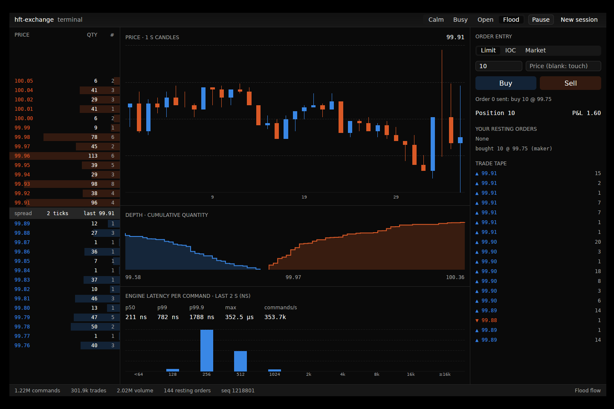

# hft-exchange

Build a low-latency exchange in Rust, one week at a time — the project
behind **[HFT-52 on tepy.dev](https://tepy.dev/hft)**.

Over 52 weeks this workspace grows from concurrency primitives into a full
exchange: order book, price-time matching, an event-sourced journal, market
data, binary and FIX protocols, a TCP gateway, pre-trade risk, telemetry,
performance work (allocation-free paths, cache-friendly books, SIMD, kernel
networking), and finally strategies, backtesting and a live demo.

| Crate | What it becomes |
| --- | --- |
| `types` | Prices, quantities, orders, commands, events (provided) |
| `sync` | Channels, SPSC/MPSC rings, cache padding, cancellation, seqlocks |
| `telemetry` | Latency histograms, metrics, clocks, open-loop load harness |
| `book` | Limit order book (then slab and ladder variants) |
| `engine` | Matching engine, order types, validation, sharding |
| `journal` | Sequenced journal, replay, snapshots, recovery, replication |
| `marketdata` | L2 updates, snapshots, gap recovery, fan-out, replay |
| `wire` | Binary protocol and zero-copy codecs |
| `fix` | FIX 4.4 parser and session layer |
| `risk` | Pre-trade checks, throttles, positions and PnL |
| `gateway` | Tokio TCP gateway, the end-to-end exchange |
| `sim` | Simulated traders, strategies, backtesting, fault injection |
| `demo`, `wasm` | The deployable demo and the in-browser engine |
| `benchkit`, `xtask` | Measurement harness and tooling (provided) |
| `apps/terminal` | A native trading terminal over your engine (GPUI) |

## How it works

Each week of the [curriculum](https://tepy.dev/hft) has a guide on the site
and a task here. The template (`main`) has every function you write stubbed
with `todo!("wNN: …")`; that week's tests and benchmarks tell you when it
works and how fast it is.

```sh
cargo xtask test --week 6      # week 6's tests
cargo xtask test --upto 6      # weeks 1–6 (the regression suite)
cargo xtask bench --week 6     # week 6's benchmarks: p50 / p99 / p99.9
cargo xtask report --upload    # send results to your tepy.dev dashboard
```

### Track your progress on tepy.dev

1. Fork this repo (the `main` branch is the template).
2. Sign in at [tepy.dev/hft/lab](https://tepy.dev/hft/lab) and create an
   upload token.
3. Run `TEPY_TOKEN=… cargo xtask report --upload` on your machine — benchmarks
   from real hardware are the ones that matter. Optionally add the token as
   a `TEPY_TOKEN` Actions secret so CI reports test status on every push.

The lab shows which weeks pass, your latency histograms and throughput over
time, and flags regressions. Week pages flip their capstone requirements
automatically from your latest report.

## See your engine trade

Once weeks 6–8 pass, your engine can drive two front ends. Both run it with simulated order flow (`sim::flow`) and let you trade against that flow:

* **In the browser.** `cargo xtask wasm` builds `crates/wasm` into a 60-odd KiB WebAssembly module, the same one [tepy.dev/hft/live](https://tepy.dev/hft/live) runs.
* **Native.** [`apps/terminal`](apps/terminal) is a GPU-rendered trading terminal built with [GPUI](https://www.gpui.rs/). It has an order book ladder, candles, depth, a live per-command latency histogram of your engine, and order entry.

  ```sh
  cd apps/terminal && cargo run --release
  ```



## Branches

* `main` — the template you work in.
* `reference` — a complete implementation. **Spoilers.** Use it to unblock
  yourself after a real attempt, or to compare designs.

## Benchmarks: read them honestly

Numbers depend on your CPU, its frequency scaling, what else is running, and
whether threads share cores. Run on an idle machine, plug in your laptop,
and compare against your own previous runs before comparing with anyone
else's. CI runners are noisy shared machines, so CI reports tests only by
default.

License: MIT.
